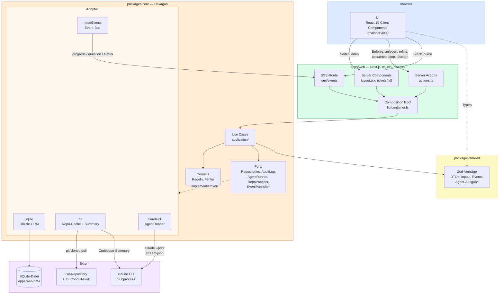

# Eigenes Beispiel-Repo + Doku auf Ist-Stand – Implementation Plan

> **For agentic workers:** REQUIRED SUB-SKILL: Use superpowers:subagent-driven-development (recommended) or superpowers:executing-plans to implement this plan task-by-task. Steps use checkbox (`- [ ]`) syntax for tracking.

**Goal:** Seed-Tickets und Vorlagen zielen auf den eigenen Fork der Blog-App „Conduit“; Roadmap, Architektur-Doku und Architektur-Bilder beschreiben den Ist-Stand nach D19.

**Architecture:** Inhaltliche Änderungen an `packages/core/src/domain/seeds.ts`, `examples/tickets/`, README und `docs/`. Die Architektur-Skizzen in `architecture.md` bleiben ASCII (D18); `architecture.mmd` wird mit mermaid-cli, `architecture-annotated.html` mit puppeteer-core jeweils über das lokal installierte Google Chrome gerendert. Spec: `docs/superpowers/specs/2026-10-28-example-repo-and-docs-design.md`.

**Tech Stack:** TypeScript/Vitest (Seeds), Markdown, Mermaid (`@mermaid-js/mermaid-cli`), puppeteer-core, Google Chrome (`/Applications/Google Chrome.app/Contents/MacOS/Google Chrome`).

**Branch:** `feature/nextjs-hexagonal`. Befehle laufen im Repo-Root `ai-sdlc/`.

**Fork:** https://github.com/wojciechlaka/node-express-realworld-example-app (existiert bereits).

---

### Task 1: Seed-Tickets, Vorlagen, README

**Files:**
- Create: `packages/core/src/domain/seeds.test.ts`
- Modify: `packages/core/src/domain/seeds.ts`
- Delete: `examples/tickets/cc-1-eigene-fragen.md`, `examples/tickets/cc-2-antwort-timer.md`, `examples/tickets/cc-3-reconnect.md`
- Create: `examples/tickets/cb-1-entwuerfe.md`, `examples/tickets/cb-2-lesezeit.md`, `examples/tickets/cb-3-kommentare-melden.md`
- Modify: `examples/tickets/README.md`, `README.md`, `apps/web/components/ResetButton.tsx:25`, `docs/superpowers/specs/2026-10-28-example-repo-and-docs-design.md` (Abnahme-Zeile)

- [ ] **Step 1: Failing test schreiben**

`packages/core/src/domain/seeds.test.ts`:

```ts
import { describe, it, expect } from 'vitest'
import { SEED_TICKETS } from './seeds'

describe('SEED_TICKETS', () => {
  it('are the three Conduit blog tickets', () => {
    expect(SEED_TICKETS.map((t) => t.title)).toEqual([
      'CB-1: Artikel als Entwurf speichern',
      'CB-2: Lesezeit bei Artikeln anzeigen',
      'CB-3: Unangemessene Kommentare melden',
    ])
  })

  it('have a non-empty description', () => {
    expect(SEED_TICKETS.every((t) => t.description.trim().length > 0)).toBe(true)
  })
})
```

- [ ] **Step 2: Test laufen lassen – muss fehlschlagen**

Run: `npm test -w packages/core -- src/domain/seeds.test.ts`
Expected: FAIL – erwartet `CB-1: …`, erhalten `CC-1: Eigene Fragen hinzufügen`.

- [ ] **Step 3: Seeds ersetzen**

`packages/core/src/domain/seeds.ts` (komplett ersetzen):

```ts
/**
 * The three example tickets restored by "Reset" and inserted into an empty database.
 * Target repo: https://github.com/wojciechlaka/node-express-realworld-example-app (Conduit blog API).
 */
export const SEED_TICKETS: ReadonlyArray<{ title: string; description: string }> = [
  {
    title: 'CB-1: Artikel als Entwurf speichern',
    description: 'Autoren wollen Artikel erst speichern und später veröffentlichen. Bis dahin soll sie niemand sonst sehen. Im Feed sollen Entwürfe natürlich nicht auftauchen.',
  },
  {
    title: 'CB-2: Lesezeit bei Artikeln anzeigen',
    description: 'Leser möchten vorher sehen, wie lange ein Artikel ungefähr dauert. Die Angabe sollte in der API mitkommen, damit das Frontend sie anzeigen kann.',
  },
  {
    title: 'CB-3: Unangemessene Kommentare melden',
    description: 'Unter manchen Artikeln landen Spam oder beleidigende Kommentare. Leser sollen solche Kommentare melden können, und irgendwer muss sich dann darum kümmern.',
  },
]
```

- [ ] **Step 4: Tests laufen lassen – müssen grün sein**

Run: `npm test -w packages/core`
Expected: PASS (alle Dateien; `seeds.test.ts` 2 Tests).

- [ ] **Step 5: Vorlagen unter `examples/tickets/` ersetzen**

```bash
git rm -q examples/tickets/cc-1-eigene-fragen.md examples/tickets/cc-2-antwort-timer.md examples/tickets/cc-3-reconnect.md
```

`examples/tickets/cb-1-entwuerfe.md`:

```markdown
# CB-1: Artikel als Entwurf speichern

Autoren wollen Artikel erst speichern und später veröffentlichen. Bis dahin soll sie
niemand sonst sehen. Im Feed sollen Entwürfe natürlich nicht auftauchen.

**Priorität:** Hoch
```

`examples/tickets/cb-2-lesezeit.md`:

```markdown
# CB-2: Lesezeit bei Artikeln anzeigen

Leser möchten vorher sehen, wie lange ein Artikel ungefähr dauert. Die Angabe sollte
in der API mitkommen, damit das Frontend sie anzeigen kann.

**Priorität:** Mittel
```

`examples/tickets/cb-3-kommentare-melden.md`:

```markdown
# CB-3: Unangemessene Kommentare melden

Unter manchen Artikeln landen Spam oder beleidigende Kommentare. Leser sollen solche
Kommentare melden können, und irgendwer muss sich dann darum kümmern.

**Priorität:** Hoch
```

`examples/tickets/README.md` (komplett ersetzen):

```markdown
# Seed-Tickets für das Beispiel-Repo „Conduit“

Diese Tickets sind bewusst roh und unterspezifiziert formuliert — so, wie sie ein Stakeholder
ins Backlog werfen würde. Sie sind der Input für den Refinement Agent, der sie gegen das Repo
[wojciechlaka/node-express-realworld-example-app](https://github.com/wojciechlaka/node-express-realworld-example-app)
schärft (Fork von [gothinkster/node-express-realworld-example-app](https://github.com/gothinkster/node-express-realworld-example-app)).
Eine Datei pro Ticket; das Format ist zugleich die Vorlage für den Markdown-Import (T-17).

Kontext zum Repo: Backend des Blogs „Conduit“ (Medium-Klon aus dem RealWorld-Projekt) —
TypeScript, Express, Prisma; REST-API für Artikel, Kommentare, Tags, Favoriten, Follow und Auth.

| Ticket | Zweck in der Demo |
|---|---|
| CB-1 Entwürfe | mittel, mehrere Schichten (Modell, API, Feed, Rechte) — echte Rückfragen |
| CB-2 Lesezeit | klein — schneller, günstiger Lauf |
| CB-3 Kommentare melden | fachlich unklar (wer moderiert? was passiert danach?) — Agent muss Regeln erfragen |

Bis zum Wechsel auf dieses Repo zielten die Seeds auf [qvest-digital/coffee-chat](https://github.com/qvest-digital/coffee-chat).
```

- [ ] **Step 6: README der Engine – Abschnitt „Ausprobieren“**

In `README.md` direkt nach dem Abschnitt `## Starten` (vor `## Struktur`) einfügen:

````markdown
## Ausprobieren

1. App starten (`npm run dev`) und http://localhost:3000 öffnen.
2. Links als Repository eintragen:
   ```
   https://github.com/wojciechlaka/node-express-realworld-example-app
   ```
   (eigener Fork der Blog-API „Conduit“, siehe [`examples/tickets/`](examples/tickets/README.md))
3. Ein Beispiel-Ticket öffnen (CB-2 ist der schnellste Lauf) und **Refine** klicken.

Ein Lauf nutzt den eigenen Claude-Login und verbraucht Tokens. Eine bestehende lokale Datenbank
zeigt die neuen Beispiel-Tickets erst nach **Reset**.
````

- [ ] **Step 7: Tooltip des Reset-Buttons**

In `apps/web/components/ResetButton.tsx` ersetzen:

```tsx
      title="Auf CC-Seed-Tickets zurücksetzen"
```
durch
```tsx
      title="Auf Beispiel-Tickets zurücksetzen"
```

- [ ] **Step 8: Abnahme-Kriterium im Spec präzisieren**

In `docs/superpowers/specs/2026-10-28-example-repo-and-docs-design.md` die Zeile

```markdown
- `grep -ri "coffee" docs README.md CLAUDE.md` liefert nur noch den Historien-Satz in der Roadmap.
```
ersetzen durch
```markdown
- `grep -ri "coffee" docs README.md CLAUDE.md examples --exclude-dir=superpowers` liefert nur Historien-Sätze:
  Roadmap, `decisions.md` (D8) und `examples/tickets/README.md`.
```

- [ ] **Step 9: Prüfen und committen**

Run: `npm test && npm run build`
Expected: alle Workspaces PASS, Build erfolgreich.

```bash
git add -A packages/core/src/domain examples README.md apps/web/components/ResetButton.tsx docs/superpowers/specs/2026-10-28-example-repo-and-docs-design.md
git commit -m "feat: Beispiel-Tickets zielen auf den eigenen Conduit-Fork

Co-Authored-By: Claude Opus 5.5 <noreply@anthropic.com>"
```

---

### Task 2: Roadmap auf Ist-Stand

**Files:**
- Modify: `docs/feature-roadmap.md` (Zeile 72 und Zeilen 97–100)

- [ ] **Step 1: Erster Use Case**

Ersetzen:

```markdown
**Backlog Refinement gegen ein Code-Repo** (zunächst [qvest-digital/coffee-chat](https://github.com/qvest-digital/coffee-chat), D8).
```
durch
```markdown
**Backlog Refinement gegen ein Code-Repo** — Ziel-Repo ist der eigene Fork
[wojciechlaka/node-express-realworld-example-app](https://github.com/wojciechlaka/node-express-realworld-example-app)
(Blog-API „Conduit“: TypeScript, Express, Prisma; D8). Anfangs zielte die Engine auf
[qvest-digital/coffee-chat](https://github.com/qvest-digital/coffee-chat).
```

- [ ] **Step 2: Architektur-Bausteine**

Ersetzen:

```markdown
- **Stack: TypeScript end-to-end** (D2) — ein Repo, eine Sprache, geteilte Typen
- Frontend: Vite / React
- Backend: Node.js / Hono
- Datenhaltung: **SQLite** (lokal, kein Infra-Overhead in der MUP-Phase) (D2)
```
durch
```markdown
- **Stack: TypeScript end-to-end** (D2) — ein Repo, eine Sprache, geteilte Typen
- App: **Next.js 16** (App Router) als einziger Prozess — Server Components lesen, Server Actions
  schreiben, eine SSE-Route streamt den Fortschritt (D19)
- Fachkern: `packages/core` nach **Ports & Adapters**; Verträge in `packages/shared` (Zod) (D19)
- Datenhaltung: **SQLite** via Drizzle (lokal, kein Infra-Overhead in der MUP-Phase) (D2)
```

- [ ] **Step 3: Prüfen und committen**

Run: `grep -nwiE "vite|hono" docs/feature-roadmap.md`
Expected: keine Treffer.

```bash
git add docs/feature-roadmap.md
git commit -m "docs: Roadmap mit Conduit-Fork und Next.js/Hexagonal-Stack

Co-Authored-By: Claude Opus 5.5 <noreply@anthropic.com>"
```

---

### Task 3: `architecture.md` auf Ist-Stand

**Files:**
- Modify: `docs/architecture.md` (§4 Tabelle + Abb. 4, §5.1 Abb. 5.1, §5.5 Bildunterschrift, §6 komplett, §8 Aufzählung)

Alle Skizzen bleiben ASCII in ```` ```text ```` -Blöcken (D18). Nach jeder Skizzen-Änderung prüfen, dass die Rahmen bündig stehen (gleiche Zeilenlänge innerhalb eines Kastens).

- [ ] **Step 1: §4 Tabelle**

Ersetzen:

```markdown
| Deployment-Einheit | lokaler Monolith | lokale App pro Nutzer | wie P3 | gehosteter Multi-Tenant-Dienst |
```
durch
```markdown
| Deployment-Einheit | lokale Next.js-App, ein Prozess (D19) | lokale App pro Nutzer | wie P3 | gehosteter Multi-Tenant-Dienst |
```

- [ ] **Step 2: §4 Abb. 4**

In der Skizze unter der Tabelle ersetzen (nur der Inhalt innerhalb der Kästen, Breiten bleiben gleich):

```text
  P2  lokaler Monolith        P3  DB herausgeloest+geteilt    P4  gleich + mehr Module    P5  gehosteter Dienst
  +-------------------+       +----------+    +---------+      +----------+   +-------+     +-----------------+
  | FE+BE+CLI+SQLite  |  -->  | App lokal| -> |geteilte |  --> | App lokal | ->|geteilte| --> | Server + DB     |
  | (eine Maschine)   |       | (FE+BE+  |    |  DB     |      | (N Module)|   |  DB    |     | Multi-Tenant    |
  +-------------------+       |  Run)    |    +---------+      +----------+   +-------+     | SSO/RBAC/Policy |
```
durch
```text
  P2  lokale App              P3  DB herausgeloest+geteilt    P4  gleich + mehr Module    P5  gehosteter Dienst
  +-------------------+       +----------+    +---------+      +----------+   +-------+     +-----------------+
  | Next.js+Kern+     |  -->  | App lokal| -> |geteilte |  --> | App lokal | ->|geteilte| --> | Server + DB     |
  | CLI+SQLite        |       | (Next.js+|    |  DB     |      | (N Module)|   |  DB    |     | Multi-Tenant    |
  +-------------------+       |  Kern)   |    +---------+      +----------+   +-------+     | SSO/RBAC/Policy |
```

- [ ] **Step 3: §5.1 Abb. 5.1**

Ersetzen:

```text
   |   Frontend (Vite/React)        |   |   Frontend (Vite/React)          |
   |   Backend  (Hono)              |   |   Backend  (Hono)                |
```
durch
```text
   |   App: Next.js (UI + Actions)  |   |   App: Next.js (UI + Actions)    |
   |   Kern: packages/core (Hexa.)  |   |   Kern: packages/core (Hexa.)    |
```

- [ ] **Step 4: §5.5 Ergänzung**

Direkt nach der Bildunterschrift `*Abb. 5.5 — …*` (der Absatz endet mit `[T-11/T-12](../tickets/phase-3-backlog.md)).*`) einen Absatz einfügen:

```markdown

Im Code ist jede Integration ein weiterer **Adapter hinter einem Port** in `packages/core`
([D19](decisions.md)); Use Cases und Domäne bleiben unverändert.
```

- [ ] **Step 5: §6 komplett ersetzen**

Den gesamten Abschnitt von `## 6. Phase 2 — Lokaler Refinement-Monolith (Ist-Bau-Stand)` bis vor `---` + `## 7.` ersetzen durch:

````markdown
## 6. Phase 2 — Lokale Refinement-App (Ist-Bau-Stand)

Alles auf einer Maschine, **ein** Prozess, keine geteilte Komponente ([D19](decisions.md)).

```text
   +=============================== eine Maschine ================================+
   |  Browser                                                                    |
   |    | RSC-Seiten (lesen)    Server Actions (schreiben)    EventSource (SSE)   |
   |    v                                                                        |
   |  apps/web  --  Next.js 16, ein Node-Prozess (next dev / next start)         |
   |    lib/container.ts = Composition Root (Engine-Singleton auf globalThis)    |
   |    |                                                                        |
   |    v                                                                        |
   |  packages/core  --  Hexagon                                                 |
   |    application (Use Cases)  -->  domain (Regeln, Fehler)                    |
   |    ports:    TicketRepository . AgentRunRepository . AuditLog               |
   |              AgentRunner . RepoProvider . EventPublisher                    |
   |    adapters: sqlite (Drizzle) . git (Repo-Cache) . claudeCli . nodeEvents   |
   |    |               |                   |                                    |
   |    v               v                   v                                    |
   |  SQLite       Repo-Checkout       "claude --print" (D3)                     |
   |  Secrets: lokal (Claude-Login, optional GITHUB_TOKEN)                       |
   +=============================================================================+
```

*Abb. 6 — Phase-2-Topologie ([D2](decisions.md), [D3](decisions.md), [D19](decisions.md); Scope →
[feature-roadmap.md](feature-roadmap.md), Tickets → [phase-2-backlog](../tickets/phase-2-backlog.md)).*

**Schichten.** `apps/web` ist der treibende Adapter: Server Components rufen Use Cases direkt auf,
Server Actions schreiben, `app/api/events/route.ts` streamt Ereignisse. `packages/core` enthält die
Fachlogik; `domain/`, `ports/` und `application/` importieren weder Adapter noch I/O — das prüft eine
ESLint-Regel. `packages/shared` hält die Zod-Verträge (DTOs, Inputs, Events, Agent-Ausgabe), die Kern
und UI teilen.

**Refine-Fluss.** Server Action → Use Case validiert, setzt `refining`, veröffentlicht ein Status-Event
und startet den Lauf im Hintergrund → Repo klonen/aktualisieren → Codebase-Summary → `claude --print`
→ Ergebnis (Rückfrage oder Refinement) → Status/Audit → Events über den `EventPublisher` an die
SSE-Route → Browser aktualisiert Fortschritt und lädt bei Status-/Fragen-Events die Seite neu.

**Grenzen.** Ein dauerhafter Node-Prozess ist Voraussetzung: lang laufende Kindprozesse, Event-Bus im
Speicher, lokale SQLite-Datei — **kein Serverless-Hosting** ([D19](decisions.md)). Die Ticket-State-Machine
gehört [datenmodell.md](datenmodell.md).

**Beispiel-Ziel.** Standard-Demo ist der Fork der Blog-API „Conduit“
([wojciechlaka/node-express-realworld-example-app](https://github.com/wojciechlaka/node-express-realworld-example-app)),
Seed-Tickets → [`examples/tickets/`](../examples/tickets/README.md).
````

- [ ] **Step 6: §8 Ergänzung**

In §8 die Zeile des Aufzählungspunkts

```markdown
- **wandert:** Persistenz (lokal → geteilt), die Concurrency-Invariante (App-Logik → DB-Constraint →
  später Server), AuthZ (keine → RBAC-lite clientseitig → SSO/volles RBAC). Secrets bleiben lokal bis
  Phase 5.
```
ersetzen durch
```markdown
- **wandert:** Persistenz (lokal → geteilt), die Concurrency-Invariante (App-Logik → DB-Constraint →
  später Server), AuthZ (keine → RBAC-lite clientseitig → SSO/volles RBAC). Secrets bleiben lokal bis
  Phase 5. Technisch wandern dabei nur **Adapter**: SQLite → Postgres-Repositories, In-Process-Event-Bus
  → prozessübergreifender `EventPublisher` (z. B. Postgres `LISTEN/NOTIFY`); Use Cases und Domäne
  bleiben ([D19](decisions.md)).
```

- [ ] **Step 7: Prüfen und committen**

Run: `grep -nwiE "vite|hono|5173" docs/architecture.md; grep -n "Hinweis:\*\* Die Phase-2" docs/architecture.md`
Expected: keine Treffer (beide Befehle).

Sichtprüfung: `sed -n '/^## 4\./,/^## 5\./p;/^## 6\./,/^## 7\./p' docs/architecture.md` — Kästen bündig.

```bash
git add docs/architecture.md
git commit -m "docs: Architektur beschreibt Next.js-App mit Hexagonal-Kern

Co-Authored-By: Claude Opus 5.5 <noreply@anthropic.com>"
```

---

### Task 4: Mermaid-Diagramm neu + PNG rendern

**Files:**
- Rewrite: `docs/architecture.mmd`
- Regenerate: `docs/architecture.png`

- [ ] **Step 1: Diagramm ersetzen**

`docs/architecture.mmd` (komplett ersetzen):



(Die Datei enthält nur den Inhalt zwischen den Fences, ohne ```` ```mermaid ````-Zeilen.)

- [ ] **Step 2: PNG rendern**

Puppeteer-Konfiguration für das lokal installierte Chrome im Scratchpad anlegen und mermaid-cli ohne Browser-Download ausführen:

```bash
S=$(mktemp -d)
printf '{ "executablePath": "/Applications/Google Chrome.app/Contents/MacOS/Google Chrome", "args": ["--no-sandbox"] }' > "$S/puppeteer.json"
PUPPETEER_SKIP_DOWNLOAD=1 npx -y @mermaid-js/mermaid-cli@11 -i docs/architecture.mmd -o docs/architecture.png -p "$S/puppeteer.json" -w 1600 -b white
file docs/architecture.png
```
Expected: `PNG image data, 1600 x …` (Breite 1600), keine Fehlermeldung.

Bei Syntaxfehlern meldet mmdc die Zeile — Diagramm korrigieren und erneut rendern.

- [ ] **Step 3: Sichtprüfung**

`docs/architecture.png` öffnen (Read-Tool / Bildbetrachter): Browser → apps/web → packages/core → Adapter → Extern ist erkennbar, keine Texte abgeschnitten.

- [ ] **Step 4: Commit**

```bash
git add docs/architecture.mmd docs/architecture.png
git commit -m "docs: Architekturdiagramm für Next.js + Hexagonal-Kern neu gerendert

Co-Authored-By: Claude Opus 5.5 <noreply@anthropic.com>"
```

---

### Task 5: Annotierte Architektur-Seite neu + PNG rendern

**Files:**
- Modify: `docs/architecture-annotated.html` (nur `<body>`-Inhalt, `<style>` ergänzen)
- Regenerate: `docs/architecture-annotated.png`

- [ ] **Step 1: Farbklasse für den Kern ergänzen**

Im `<style>`-Block nach der Zeile `.purple h2 { color: #7e22ce; }` einfügen:

```css
  .orange { background: #fff7ed; border-color: #fed7aa; }
  .orange h2 { color: #c2410c; }
```

- [ ] **Step 2: `<div class="legend"> … </div>` komplett ersetzen**

Den gesamten Block von `<div class="legend">` bis zu seinem schließenden `</div>` (direkt vor `</body>`) ersetzen durch:

```html
  <div class="legend">

    <div class="block blue">
      <h2><span class="dot" style="background:#3b82f6"></span>Browser (blau)</h2>
      <p>Die Web-Oberfläche unter <code>localhost:3000</code>. Hier legst du Tickets an, startest Refinements und beantwortest Rückfragen des Agenten. Jedes Ticket hat eine eigene URL (<code>/tickets/T-1</code>). React 19 Client Components für alles Interaktive: Live-Fortschritt, Timer, Rückfrage, Buttons.</p>
    </div>

    <div class="block yellow">
      <h2><span class="dot" style="background:#ca8a04"></span>packages/shared (gelb)</h2>
      <p>Zod-Verträge zwischen Kern und UI: Ticket- und Run-DTOs, Eingaben (Ticket anlegen, Refine, Antwort), die drei Event-Typen und das Schema der Agent-Ausgabe. Der Kern validiert damit, die UI nutzt die Typen — es gibt keine von Hand nachgebauten API-Typen.</p>
    </div>

    <div class="block green" style="grid-column: span 2">
      <h2><span class="dot" style="background:#16a34a"></span>apps/web — Next.js 16, ein Prozess (grün)</h2>
      <ul>
        <li><strong>Server Components</strong> — rendern Ticket-Liste und Ticket-Detail auf dem Server und rufen dafür direkt die Use Cases auf</li>
        <li><strong>Server Actions</strong> — Ticket anlegen, Refinement starten, Antwort senden, Stoppen, Löschen, Reset; danach wird die Seite neu geladen (<code>revalidatePath</code>)</li>
        <li><strong>SSE-Route <code>/api/events</code></strong> — hält pro Browser-Tab einen Stream offen und reicht Ereignisse des Kerns durch</li>
        <li><strong>Composition Root <code>lib/container.ts</code></strong> — erzeugt einmal pro Prozess die Engine (Datenbank, Adapter, Event-Bus) und hält sie auf <code>globalThis</code></li>
      </ul>
    </div>

    <div class="block orange" style="grid-column: span 2">
      <h2><span class="dot" style="background:#ea580c"></span>packages/core — Hexagon (orange)</h2>
      <ul>
        <li><strong>Use Cases</strong> — die Fachabläufe: Ticket anlegen, Refinement starten, Rückfrage beantworten, Stoppen, Löschen, Reset; Agent-Läufe laufen im Hintergrund weiter</li>
        <li><strong>Domäne</strong> — reine Regeln ohne I/O: wann ein Refinement starten darf, wann eine Antwort angenommen wird, Aufbau des Frage-Antwort-Verlaufs, Fachfehler</li>
        <li><strong>Ports</strong> — Schnittstellen, die der Kern braucht: Repositories, Audit-Log, AgentRunner, RepoProvider, EventPublisher</li>
        <li><strong>Adapter</strong> — <code>sqlite</code> (Drizzle), <code>git</code> (Repo-Cache + Codebase-Summary), <code>claudeCli</code> (Agent als Subprocess, Zod-Validierung, ein Retry), <code>nodeEvents</code> (Event-Bus)</li>
        <li><strong>Abhängigkeitsregel</strong> — Domäne, Ports und Use Cases importieren keine Adapter; eine ESLint-Regel prüft das</li>
      </ul>
    </div>

    <div class="block purple" style="grid-column: span 2">
      <h2><span class="dot" style="background:#9333ea"></span>Extern (lila)</h2>
      <ul>
        <li><strong>SQLite-Datei</strong> — <code>apps/web/data/refinement.db</code>: Tickets, Agent-Läufe, Audit-Events</li>
        <li><strong>Git-Repository</strong> — das zu analysierende Projekt, z. B. der Conduit-Fork; wird lokal gecacht</li>
        <li><strong>claude CLI</strong> — bekommt den Prompt über stdin und liefert die Antwort als JSON-Stream über stdout</li>
      </ul>
    </div>

    <div class="block gray" style="background:#f8fafc; border-color:#e2e8f0; grid-column: span 2">
      <h2><span class="dot" style="background:#64748b"></span>Die zwei Wege zwischen Browser und Server</h2>
      <div class="arrows">
        <div class="arrow-block">
          <strong>↓ Server Actions (Browser → Server)</strong>
          Befehle wie „Refinement starten“ oder „Antwort senden“. Der Kern prüft und validiert, Fachfehler kommen als Meldung zurück in die Oberfläche.
        </div>
        <div class="arrow-block">
          <strong>↑ SSE (Server → Browser)</strong>
          Live-Ereignisse während eines Laufs: Fortschritt erscheint sofort im Log; bei Status-Wechsel oder Rückfrage lädt der Browser die Seite neu und zeigt den aktuellen Stand.
        </div>
      </div>
    </div>

    <div class="block" style="background:#fff7ed; border-color:#fed7aa; grid-column: span 2">
      <h2><span class="dot" style="background:#ea580c"></span>Wie der Event-Bus funktioniert</h2>
      <p style="margin-bottom:14px">Der Event-Bus ist ein Port (<code>EventPublisher</code>) mit einem Adapter auf Basis eines Node.js-<code>EventEmitter</code> — ein Kanal pro Ticket, kein externes System. Use Cases und SSE-Route kennen sich nicht; beide sprechen nur mit dem Port. In Phase 3 wird nur der Adapter getauscht (z. B. Postgres <code>LISTEN/NOTIFY</code>).</p>

      <div style="display:grid; grid-template-columns: 1fr 1fr; gap: 20px; margin-bottom: 14px">
        <div>
          <strong style="font-size:13px; display:block; margin-bottom:6px">Ablauf</strong>
          <div style="font-family: monospace; font-size: 12.5px; background:#fff; border:1px solid #fed7aa; border-radius:8px; padding:14px; line-height:2">
            Use Case / Agent-Lauf<br>
            &nbsp;&nbsp;│ events.publish({ type, ticketId, … })<br>
            &nbsp;&nbsp;▼<br>
            EventPublisher (nodeEvents, Kanal ticket:T-1)<br>
            &nbsp;&nbsp;│ subscribe(ticketId, handler) — eine Anmeldung pro Tab<br>
            &nbsp;&nbsp;▼<br>
            SSE-Route /api/events<br>
            &nbsp;&nbsp;│ data: {"type":"progress", …}<br>
            &nbsp;&nbsp;▼<br>
            Browser (useSSE)
          </div>
        </div>
        <div>
          <strong style="font-size:13px; display:block; margin-bottom:6px">Drei Event-Typen</strong>
          <table style="font-size:13px; border-collapse:collapse; width:100%">
            <thead>
              <tr style="background:#fed7aa22">
                <th style="text-align:left; padding:6px 10px; border-bottom:1px solid #fed7aa">Event</th>
                <th style="text-align:left; padding:6px 10px; border-bottom:1px solid #fed7aa">Wann</th>
              </tr>
            </thead>
            <tbody>
              <tr>
                <td style="padding:6px 10px; border-bottom:1px solid #fff0e6; font-family:monospace">progress</td>
                <td style="padding:6px 10px; border-bottom:1px solid #fff0e6; color:#555">Zwischenstand des Laufs — erscheint direkt im Log</td>
              </tr>
              <tr>
                <td style="padding:6px 10px; border-bottom:1px solid #fff0e6; font-family:monospace">status</td>
                <td style="padding:6px 10px; border-bottom:1px solid #fff0e6; color:#555">Ticket wechselt Status, z. B. <em>refining → review</em> — Seite wird neu geladen</td>
              </tr>
              <tr>
                <td style="padding:6px 10px; font-family:monospace">question</td>
                <td style="padding:6px 10px; color:#555">Der Agent stellt eine Rückfrage — Seite wird neu geladen und zeigt das Antwortfeld</td>
              </tr>
            </tbody>
          </table>
          <p style="font-size:12.5px; color:#666; margin-top:10px">Ist für ein Ticket gerade kein Tab verbunden, geht das Ereignis verloren — der Zustand selbst liegt in der Datenbank und wird beim Laden der Seite gelesen.</p>
        </div>
      </div>

      <p style="font-size:13px; color:#555"><strong>Warum dieser Umweg?</strong> Ein Agent-Lauf läuft im Hintergrund weiter, lange nachdem die Server Action geantwortet hat. Über den Port bleiben Fachlogik und Transport getrennt — der Kern weiß nichts von HTTP oder Browsern.</p>
    </div>

  </div>
```

Außerdem den Untertitel ersetzen:

```html
  <p class="subtitle">AI-gestützte Ticket-Verfeinerung: Ein Agent analysiert Tickets gegen die Codebase und liefert strukturierte Implementierungspläne.</p>
```
durch
```html
  <p class="subtitle">AI-gestützte Ticket-Verfeinerung: Ein Agent analysiert Tickets gegen die Codebase und liefert strukturierte Implementierungspläne. Eine Next.js-App, Fachkern nach Ports &amp; Adapters.</p>
```

- [ ] **Step 3: PNG rendern (puppeteer-core mit lokalem Chrome)**

Das bestehende `docs/screenshot.mjs` braucht `puppeteer` im Repo; stattdessen wird dieselbe Logik einmalig in einem temporären Verzeichnis ausgeführt (nichts davon wird committet):

```bash
R=$(pwd)
T=$(mktemp -d)
cd "$T" && npm init -y >/dev/null && npm install --silent puppeteer-core@24 >/dev/null
cat > render.mjs <<'EOF'
import puppeteer from 'puppeteer-core'
const [html, out] = process.argv.slice(2)
const browser = await puppeteer.launch({
  executablePath: '/Applications/Google Chrome.app/Contents/MacOS/Google Chrome',
  headless: true,
})
const page = await browser.newPage()
await page.setViewport({ width: 1700, height: 800, deviceScaleFactor: 2 })
await page.goto(`file://${html}`, { waitUntil: 'networkidle0' })
const height = await page.evaluate(() => document.body.scrollHeight)
await page.setViewport({ width: 1700, height, deviceScaleFactor: 2 })
await page.screenshot({ path: out, fullPage: true })
await browser.close()
console.log('done')
EOF
node render.mjs "$R/docs/architecture-annotated.html" "$R/docs/architecture-annotated.png"
cd "$R" && file docs/architecture-annotated.png
```
Expected: `done`, dann `PNG image data, 3400 x …`.

Voraussetzung: `docs/architecture.png` aus Task 4 ist bereits neu gerendert (die Seite bettet es ein).

- [ ] **Step 4: Sichtprüfung**

`docs/architecture-annotated.png` ansehen: neues Diagramm oben, Blöcke Browser / shared / apps/web / packages/core / Extern / zwei Wege / Event-Bus, keine Erwähnung von Vite, Hono oder :5173.

- [ ] **Step 5: Commit**

```bash
git add docs/architecture-annotated.html docs/architecture-annotated.png
git commit -m "docs: annotierte Architektur-Seite auf Ist-Stand, Bild neu gerendert

Co-Authored-By: Claude Opus 5.5 <noreply@anthropic.com>"
```

---

### Task 6: Abnahme

- [ ] **Step 1: Tests, Build, Lint**

Run: `npm test && npm run build && npm run lint`
Expected: alles grün.

- [ ] **Step 2: Text-Prüfungen**

```bash
grep -ri "coffee" docs README.md CLAUDE.md examples --exclude-dir=superpowers
grep -rwiE "vite|hono|5173" docs --exclude-dir=superpowers
```
Expected: „coffee“ nur in `docs/feature-roadmap.md` (Historien-Satz), `docs/decisions.md` (D8) und `examples/tickets/README.md`; Vite/Hono/5173 nur in `docs/decisions.md`.

- [ ] **Step 3: Seeds in der App**

Mit leerer Test-Datenbank starten, damit die bestehende lokale DB unangetastet bleibt:

```bash
DB_PATH=$(mktemp -d)/seed-check.db npm run dev
```
(im Hintergrund), dann:

```bash
curl -s http://localhost:3000/ | grep -o 'CB-[123]: [^<\\]*' | sort -u
```
Expected: die drei CB-Titel. Server danach stoppen.

- [ ] **Step 4: Stand festhalten**

`git status --short` muss leer sein. Ergebnis an den Nutzer berichten (nicht pushen).
